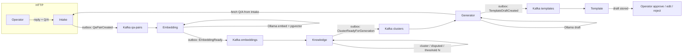
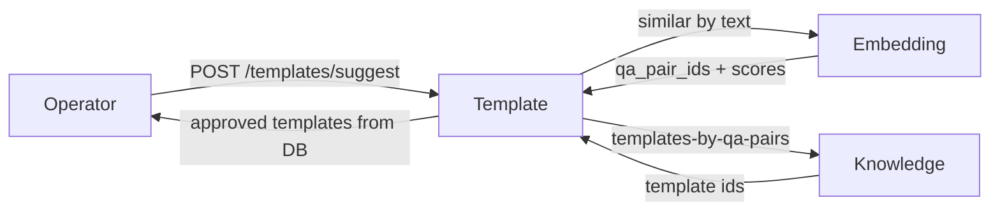

# support-brain

A human-in-the-loop “second brain” for support teams: operators chat with customers, useful Q/A pairs are stored and clustered, a local LLM drafts reply templates when a cluster is large enough, and humans approve or reject drafts. Approved templates are **suggested** to operators for similar questions — never auto-sent to customers.


## Features

What exists in this repository today:

- **Auth** — register / login, JWT (`client` / `operator` roles)
- **Intake** — conversations & messages; operator replies create durable `qa_pairs` and publish `QaPairCreated` via an outbox
- **Embedding** — Ollama embeddings stored in PostgreSQL/`pgvector`; consumes `QaPairCreated`, publishes `EmbeddingReady`; similarity search by `qa_pair_id` and by text
- **Knowledge** — similarity clustering, disputed Q/A handling, generation threshold **N**; consumes `EmbeddingReady`, publishes `ClusterReadyForGeneration`; resolves Q/A → template ids for suggest
- **Generator** — consumes cluster-ready events, loads Q/A from Intake, drafts a reply with a local Ollama chat model, publishes `TemplateDraftCreated` (idempotent generation jobs per cluster)
- **Template** — stores drafts; operator list / get / edit / approve / reject; suggest via Embedding + Knowledge
- **Local stack** — Docker Compose with PostgreSQL (pgvector), Kafka (KRaft native), Ollama; no paid cloud LLM required for local development
- **CI** — format, vet, golangci-lint, tests, and per-service builds (`.github/workflows/backend-ci.yml`)

## Architecture

Six Go microservices share one module (`github.com/ch4rniauski/support-brain`) under `backend/`. Synchronous HTTP for APIs; Kafka + transactional outbox for the learning pipeline. Operators remain in the loop for every customer-facing reply and for template moderation.

### Learning flow (async)



### Suggest flow (sync)



## Repository structure

```
support-brain/
├── .github/workflows/          # Backend CI
└── backend/
    ├── cmd/                    # Service entrypoints
    │   ├── auth/
    │   ├── intake/
    │   ├── embedding/
    │   ├── knowledge/
    │   ├── generator/
    │   └── template/
    ├── internal/               # Per-service code (api, config, domain, handler, …)
    │   ├── auth/
    │   ├── intake/
    │   ├── embedding/
    │   ├── knowledge/
    │   ├── generator/
    │   └── template/
    ├── pkg/                    # Shared libraries
    │   ├── auth/               # JWT middleware & token manager
    │   ├── config/
    │   ├── httpx/
    │   ├── kafka/
    │   ├── outbox/
    │   └── postgres/
    ├── deployment/             # Docker Compose, Dockerfiles, env file
    │   ├── docker-compose.yml
    │   ├── Dockerfile.*
    │   └── .env                # Local compose env (gitignored)
    ├── scripts/migrate.sh      # goose migrations for all services
    ├── go.mod
    └── .golangci.yml
```

## Tech stack

| Area | Choice |
|------|--------|
| Language | Go (`go 1.27` in `backend/go.mod`) |
| HTTP | [chi](https://github.com/go-chi/chi) |
| Validation | go-playground/validator |
| Auth | JWT (`golang-jwt/jwt`), bcrypt |
| DB | PostgreSQL + [pgx](https://github.com/jackc/pgx), [pgvector](https://github.com/pgvector/pgvector) |
| Messaging | Kafka ([segmentio/kafka-go](https://github.com/segmentio/kafka-go)), transactional outbox |
| LLM / embeddings | [Ollama](https://ollama.com) (local) |
| Config | [envconfig](https://github.com/kelseyhightower/envconfig) |
| Migrations | [goose](https://github.com/pressly/goose) |
| Containers | Docker Compose |

## Prerequisites

- Docker & Docker Compose
- Go matching `backend/go.mod` (for local `go run` / tests)
- [goose](https://github.com/pressly/goose) CLI (for migrations):  
  `go install github.com/pressly/goose/v3/cmd/goose@latest`

## Quick start

### 1. Clone

```bash
git clone https://github.com/ch4rniauski/support-brain.git
cd support-brain
```

### 2. Environment

Compose reads `backend/deployment/.env` (gitignored). There is no committed `.env.example`; create the file from the variables below (or copy from an existing local `.env`).

Minimum useful values for Compose:

```bash
# backend/deployment/.env
POSTGRES_HOST=postgres
POSTGRES_PORT=5432
POSTGRES_USER=postgres
POSTGRES_PASSWORD=postgres
POSTGRES_DB=support-brain

AUTH_JWT_SECRET=change-me-to-a-long-random-string
AUTH_TOKEN_TTL=24h

HTTP_PORT=8080

AUTH_HOST_PORT=8081
INTAKE_HOST_PORT=8082
TEMPLATE_HOST_PORT=8083
KNOWLEDGE_HOST_PORT=8084
GENERATOR_HOST_PORT=8085
EMBEDDING_HOST_PORT=8086

OLLAMA_PORT=11434
OLLAMA_BASE_URL=http://ollama:11434
OLLAMA_EMBEDDING_MODEL=nomic-embed-text
CHAT_MODEL=llama3.2

KAFKA_BROKERS=kafka:9092
KAFKA_HOST_PORT=9092
KAFKA_QA_PAIR_TOPIC=qa-pairs
KAFKA_EMBEDDING_TOPIC=embeddings
KAFKA_EMBEDDING_GROUP=embedding-service
KAFKA_CLUSTER_TOPIC=clusters
KAFKA_KNOWLEDGE_GROUP=knowledge-service
KAFKA_TEMPLATE_TOPIC=templates
KAFKA_TEMPLATE_GROUP=template-service
KAFKA_GENERATOR_GROUP=generator-service

OUTBOX_POLL_INTERVAL=1s
OUTBOX_BATCH_SIZE=100

EMBEDDING_BASE_URL=http://embedding:8080
KNOWLEDGE_BASE_URL=http://knowledge:8080
INTAKE_BASE_URL=http://intake:8080

SIMILARITY_THRESHOLD=0.85
SEARCH_LIMIT=10
GENERATION_THRESHOLD_N=5
SUGGEST_SIMILARITY_THRESHOLD=0.85
SUGGEST_SEARCH_LIMIT=10

PROMPT_VERSION=v1
MAX_ATTEMPTS=3
MAX_OUTPUT_CHARS=4000
MIN_OUTPUT_CHARS=20

EMBEDDING_CONSUMER_MAX_ATTEMPTS=5
EMBEDDING_CONSUMER_INITIAL_BACKOFF=1s
EMBEDDING_CONSUMER_MAX_BACKOFF=30s
KNOWLEDGE_CONSUMER_MAX_ATTEMPTS=5
KNOWLEDGE_CONSUMER_INITIAL_BACKOFF=1s
KNOWLEDGE_CONSUMER_MAX_BACKOFF=30s
GENERATOR_CONSUMER_MAX_ATTEMPTS=5
GENERATOR_CONSUMER_INITIAL_BACKOFF=1s
GENERATOR_CONSUMER_MAX_BACKOFF=30s
TEMPLATE_CONSUMER_MAX_ATTEMPTS=5
TEMPLATE_CONSUMER_INITIAL_BACKOFF=1s
TEMPLATE_CONSUMER_MAX_BACKOFF=30s
```

First Compose startup pulls Ollama models (`nomic-embed-text`, `llama3.2`) via the `ollama-init` job — that can take several minutes.

### 3. Start the stack

```bash
cd backend/deployment
docker compose up --build -d
```

### 4. Run migrations

With Postgres reachable on the host (`localhost:5432` by default):

```bash
cd backend
export POSTGRES_HOST=localhost
export POSTGRES_PORT=5432
export POSTGRES_USER=postgres
export POSTGRES_PASSWORD=postgres
export POSTGRES_DB=support-brain
./scripts/migrate.sh up
```

Each service uses its own goose version table (`goose_auth_version`, `goose_intake_version`, …).

### 5. Host ports

| Service | Host URL |
|---------|----------|
| auth | `http://localhost:8081` |
| intake | `http://localhost:8082` |
| template | `http://localhost:8083` |
| knowledge | `http://localhost:8084` |
| generator | `http://localhost:8085` |
| embedding | `http://localhost:8086` |
| PostgreSQL | `localhost:5432` |
| Kafka | `localhost:9092` |
| Ollama | `http://localhost:11434` |

All API containers listen on internal port `8080`.

### 6. Healthcheck

Every service exposes chi heartbeat:

```bash
curl -s http://localhost:8081/health
curl -s http://localhost:8082/health
```

### 7. Example API calls

Register and login (new users get role `client`):

```bash
curl -s -X POST http://localhost:8081/register \
  -H 'Content-Type: application/json' \
  -d '{"login":"alice","password":"password123"}'

curl -s -X POST http://localhost:8081/login \
  -H 'Content-Type: application/json' \
  -d '{"login":"alice","password":"password123"}'
```

Operator-only routes (`/messages/replies`, template moderation/suggest, embedding `/similar/by-text`) require a JWT with role `operator`. Registration currently assigns `client` only — promote a user in Postgres for local demos:

```sql
UPDATE users SET role = 'operator' WHERE login = 'alice';
```

Then log in again and use the token:

```bash
# Client opens a conversation
curl -s -X POST http://localhost:8082/messages \
  -H 'Content-Type: application/json' \
  -d '{"body":"How do I reset my password?"}'

# Operator replies (creates qa_pair + QaPairCreated)
curl -s -X POST http://localhost:8082/messages/replies \
  -H "Authorization: Bearer $TOKEN" \
  -H 'Content-Type: application/json' \
  -d '{
    "conversation_id":"<conversation-uuid>",
    "question":"How do I reset my password?",
    "body":"Open Settings → Security → Reset password, then check your email.",
    "answer_source":"manual"
  }'
```

List draft templates and approve one:

```bash
curl -s "http://localhost:8083/templates?status=draft" \
  -H "Authorization: Bearer $TOKEN"

curl -s -X POST "http://localhost:8083/templates/<template-id>/approve" \
  -H "Authorization: Bearer $TOKEN"
```

Suggest templates for a new question:

```bash
curl -s -X POST http://localhost:8083/templates/suggest \
  -H "Authorization: Bearer $TOKEN" \
  -H 'Content-Type: application/json' \
  -d '{"question":"How can I reset the password?"}'
```

### 8. Run a service locally (optional)

Infra via Compose; one binary on the host:

```bash
cd backend/deployment && docker compose up -d postgres kafka ollama ollama-init
cd ../
export HTTP_PORT=8082
export POSTGRES_HOST=localhost
export KAFKA_BROKERS=localhost:9092
# …plus the other vars from Configuration
go run ./cmd/intake
```

There is no root `Makefile`; use `docker compose` and `go run ./cmd/<service>`.

## Main flows

### Learning (Q/A → draft)

1. Client `POST /messages` on Intake (optional `conversation_id`).
2. Operator `POST /messages/replies` with question + answer → durable `qa_pair` + outbox `QaPairCreated`.
3. Embedding embeds the question (Ollama), stores the vector, publishes `EmbeddingReady`.
4. Knowledge finds similar Q/A, grows clusters / marks disputed pairs; when member count ≥ `GENERATION_THRESHOLD_N`, publishes `ClusterReadyForGeneration`.
5. Generator loads example Q/A from Intake, calls Ollama chat, writes a generation job, publishes `TemplateDraftCreated`.
6. Template imports a **draft**; a human must edit / approve / reject.

### Template moderation

- `GET /templates?status=draft|approved|rejected|archived`
- `PATCH /templates/{id}` — edit draft body
- `POST /templates/{id}/approve` / `reject`

### Suggest

`POST /templates/suggest` with `{ "question": "..." }` → Embedding similarity by text → Knowledge maps Q/A to template ids → Template returns approved bodies (suggestion only; Intake still sends the operator’s reply).

## Configuration

Important environment variables (from service configs and Compose):

| Variable | Used by | Purpose / default |
|----------|---------|-------------------|
| `HTTP_PORT` | all | Listen port (`8080`) |
| `POSTGRES_*` | all | DB connection (`localhost` / `postgres` / `support-brain`) |
| `AUTH_JWT_SECRET` | auth, intake, embedding, template | JWT HMAC secret |
| `AUTH_TOKEN_TTL` | same | Token lifetime (`24h`) |
| `KAFKA_BROKERS` | intake, embedding, knowledge, generator, template | Broker list |
| `KAFKA_QA_PAIR_TOPIC` | intake, embedding | Default `qa-pairs` |
| `KAFKA_EMBEDDING_TOPIC` | embedding, knowledge | Default `embeddings` |
| `KAFKA_CLUSTER_TOPIC` | knowledge, generator | Default `clusters` |
| `KAFKA_TEMPLATE_TOPIC` | generator, template | Default `templates` |
| `KAFKA_*_GROUP` | consumers | Consumer group ids |
| `OUTBOX_POLL_INTERVAL` / `OUTBOX_BATCH_SIZE` | publishers | Outbox poll (`1s` / `100`) |
| `OLLAMA_BASE_URL` | embedding | Embeddings API |
| `LLM_BASE_URL` | generator | Chat API (Compose sets from `OLLAMA_BASE_URL`) |
| `OLLAMA_EMBEDDING_MODEL` | embedding, knowledge | Default `nomic-embed-text` |
| `CHAT_MODEL` | generator | Default `llama3.2` |
| `EMBEDDING_BASE_URL` | knowledge, template | Embedding service base URL |
| `KNOWLEDGE_BASE_URL` | template | Knowledge service base URL |
| `INTAKE_BASE_URL` | generator | Intake base URL |
| `SIMILARITY_THRESHOLD` / `SEARCH_LIMIT` | knowledge | Clustering knobs (`0.85` / `10`) |
| `GENERATION_THRESHOLD_N` | knowledge | Cluster size before generation (`5`) |
| `SUGGEST_SIMILARITY_THRESHOLD` / `SUGGEST_SEARCH_LIMIT` | template | Suggest search knobs |
| `PROMPT_VERSION` / `MAX_ATTEMPTS` / `MAX_*_CHARS` | generator | Draft generation limits |
| `*_CONSUMER_MAX_ATTEMPTS` / `*_BACKOFF` | consumers | Kafka retry policy |

## Development notes

- **Monorepo**: one Go module; binaries under `backend/cmd/*`; shared JWT/outbox/Kafka/Postgres helpers in `backend/pkg/`.
- **Outbox**: Intake, Embedding, Knowledge, and Generator write events in the same DB transaction as domain changes; a poller publishes to Kafka.
- **Idempotency**: embeddings are unique on `(qa_pair_id, model_name)`; template drafts are unique on `generation_job_id`; Knowledge skips already-clustered / already-disputed Q/A; Generator tracks jobs per cluster.
- **Auth**: `POST /register` creates role `client`. Operator APIs need role `operator` (DB update for local use). Template → Embedding service calls mint an operator JWT internally for `/similar/by-text`.
- **Tests / lint**: from `backend/`: `go test ./...`, `golangci-lint run` (see CI workflow).

## Roadmap

Honest next steps relative to the current code:

- Propagate template **approve** into Knowledge (`active_template_id` / `has_approved`) so suggest mapping stays consistent end-to-end
- First-class operator provisioning (not only `client` registration + SQL)
- Persist / expose **template usage** (`template_usages` table exists; API wiring is incomplete)
- Operator UX / frontend; richer disputed-pair resolution APIs
- Hardening for non-local deploy (secrets, multi-broker Kafka, observability)

## License

TBD
